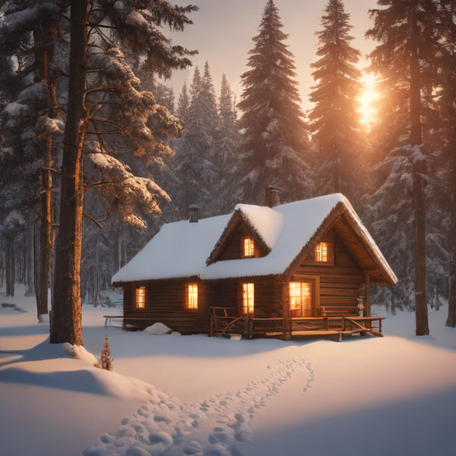
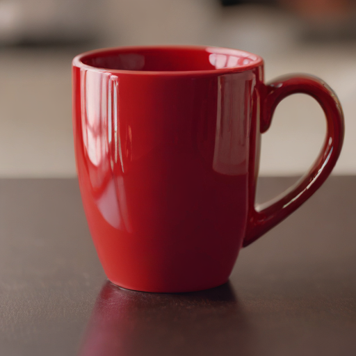
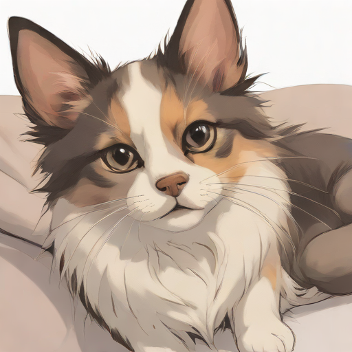

# pixel-bag

Generate images from text prompts on your own machine with Hugging Face [diffusers](https://github.com/huggingface/diffusers) and [SDXL-Turbo](https://huggingface.co/stabilityai/sdxl-turbo).

It's built for Apple Silicon Macs and uses the GPU through PyTorch's MPS backend. It also runs on NVIDIA GPUs (CUDA) and falls back to the CPU. SDXL-Turbo makes a usable image in 1–4 steps, so each image usually takes a few seconds and fits in 16 GB of memory.



## Requirements

- Python 3.12+
- [uv](https://docs.astral.sh/uv/)
- About 7 GB of disk for the model weights. They download to `~/.cache/huggingface` on the first run.

## Usage

```sh
uv run generate.py "a cozy cabin in a snowy forest, golden hour"
```

Images are saved to `outputs/<timestamp>.png` unless you pass `--out`. Each PNG stores its prompt, model, steps and seed in its metadata. To read them back:

```sh
uv run python -c "from PIL import Image; print(Image.open('outputs/<file>.png').text)"
```

| Option | Default | Description |
| --- | --- | --- |
| `--steps` | `2` | Denoising steps. 1–4 is plenty for Turbo. |
| `--seed` | random | Set a seed to get the same image again. A random seed is still saved in the metadata. |
| `--out` | `outputs/<timestamp>.png` | Where to save the image. |

```sh
uv run generate.py "a corgi astronaut" --steps 4 --seed 42 --out corgi.png
```

## Gallery

Images in `outputs/` and the prompts that made them:

| Image | Prompt |
| --- | --- |
|  | `a mug that is red that's on a table` |
|  | `Give me a image of a cat dog like the cartoon but realistic` |
|  | `a cozy cabin in a snowy forest, golden hour` (not recorded; most likely this prompt) |

## Using a different model

To use another text-to-image model from the Hugging Face Hub, change `MODEL_ID` in `generate.py`. Non-Turbo models usually need more steps (20–50) and a `guidance_scale` above 0.
